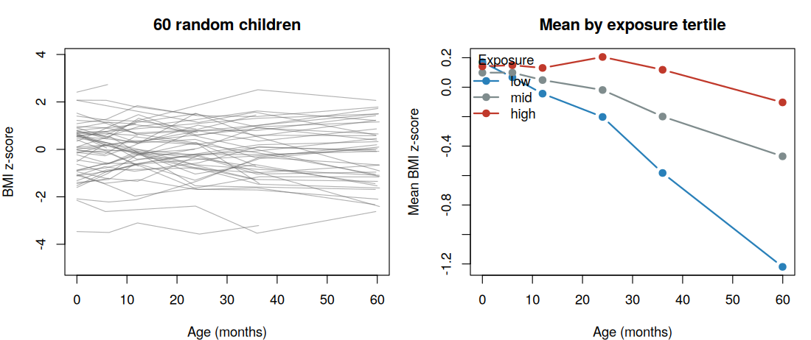
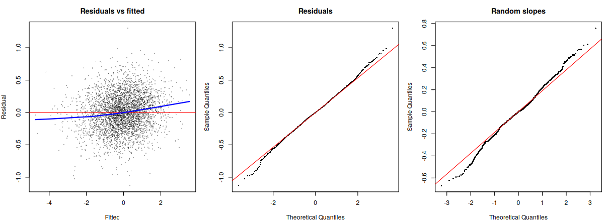
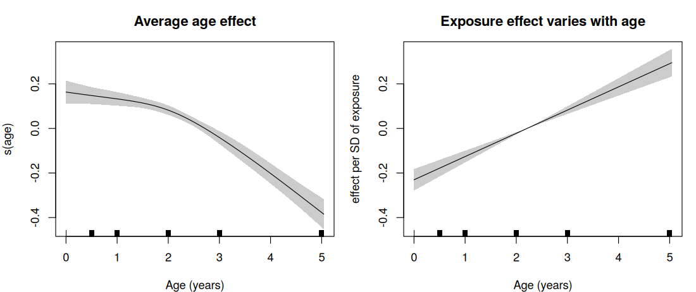
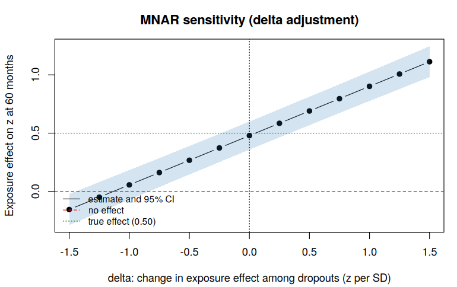
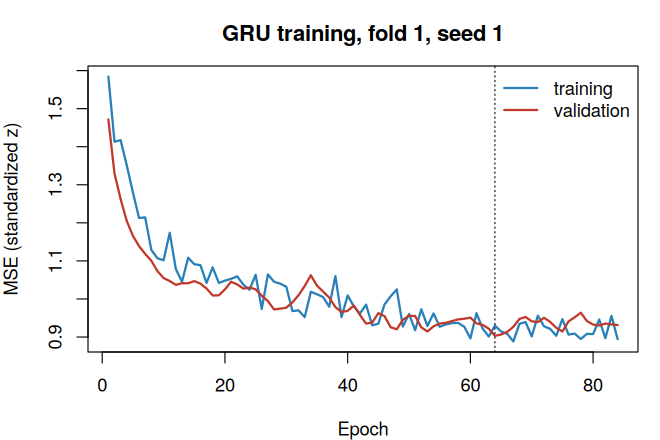

# Part 1: Longitudinal Data Analysis in a Pediatric Birth Cohort (R)

Statistical Programmer portfolio for a TPG / NICHD-style health study. The notebook `Part1_Longitudinal_Analysis_TPG.ipynb` analyzes a **synthetic** birth cohort of 800 children measured at birth and at 6, 12, 24, 36 and 60 months. It covers mixed models, marginal versus conditional models, missing-data methods, survival analysis, and **neural networks compared head to head with the classical methods**.

> **All data are synthetic.** No real participants are involved. The truth is known by construction (for example, the exposure speeds growth by exactly 0.10 BMI z-score per SD per year), so every estimator can be checked against it.

## The study setting

| Item | Value |
|---|---|
| Children | 800 (4,800 scheduled child-visits, 3,656 observed) |
| Retention at 60 months | 61.0% (monotone dropout depending on earlier BMI, plus 10% missed visits) |
| Outcomes | BMI z-score (continuous), neurodevelopmental delay (repeated binary, 15.1% of observed visits), time to asthma (125 events, 16%) |
| Exposure | Standardized prenatal factor, with a known effect on growth rate |

## Methods and tools

| Question | Method | R tool | SAS equivalent |
|---|---|---|---|
| Growth trajectories with child-specific lines | Linear mixed models, random intercept and slope | `lme4`, `nlme` | `PROC MIXED` |
| Correlated repeated errors at irregular times | Continuous-time AR(1) covariance | `nlme::corCAR1` | `PROC MIXED` with `TYPE=SP(POW)` |
| Nonlinear trajectories | GAMM with smooth age effects and random effects | `mgcv::bam` | `PROC GAMPL` |
| Population-average effects, repeated binary | GEE with robust standard errors | `geepack` | `PROC GENMOD` with `REPEATED` |
| Child-specific effects, repeated binary | Mixed-effects logistic regression | `lme4::glmer` | `PROC GLIMMIX` |
| Missing data | Multiple imputation (MAR), delta-adjusted tipping point (MNAR) | `mice` | `PROC MI`, `PROC MIANALYZE` |
| Time to event | Cox proportional hazards | `survival` | `PROC PHREG` |
| Neural alternatives | GRU sequence model, deep survival network | base R (from scratch) | `PROC NNET` (SAS Viya) |

The equivalent SAS programs will be provided in the SAS appendix (not yet included in this repository).

## Results

### Mixed models recover the truth

A random slope is strongly preferred over a random intercept alone (likelihood-ratio chi-square 1517 on 2 df, p < 2e-16). The estimated **exposure-by-time effect is 0.104 per year (95% CI 0.082 to 0.125)** against a true value of 0.10. The variance components are close to the truth: intercept SD 0.90 (true 0.80), slope SD 0.26 (true 0.25).

**Residual correlation.** Continuous-time AR(1) errors improve the fit substantially:

| Structure | AIC |
|---|---|
| Random intercept, independent errors | 8138 |
| Random intercept + CAR(1) errors | 6541 |
| Random intercept + slope, independent errors | 6625 |
| **Random intercept + slope + CAR(1) errors** | **6343** |

The estimated CAR(1) correlation is 0.457 per year (true 0.5).

Residual and random-effect plots look reasonable. A Shapiro-Wilk test of the random slopes gives p = 0.008, a mild departure from normality that does not change the conclusions.

**GAMM.** The age curve is nonlinear (effective degrees of freedom 3.2), while the exposure effect on growth is linear in age (effective degrees of freedom 1.0). The mean curve agrees with the quadratic mixed model to within 0.03 z-units at every age. The parametric `exposure` coefficient in the GAMM is not the effect at birth, because the age-varying exposure smooth is centered; interpret the exposure effect through the smooth.

### Marginal versus conditional odds ratios

For the repeated binary outcome the same exposure gives different odds ratios depending on the question asked:

| Model | Exposure OR (95% CI) |
|---|---|
| GEE, exchangeable (population-average) | 1.37 (1.20 to 1.56) |
| GEE, independence (population-average) | 1.38 (1.21 to 1.56) |
| GLMM random intercept (child-specific) | 1.43 (1.23 to 1.68) |

The child-specific odds ratio is larger than the population-average one, as theory predicts when children differ a lot in baseline risk (the true conditional OR is 1.42). The estimated random-intercept SD is 1.01 against a true 1.2.

*A note on the other coefficients.* The true effect of sex (OR about 1.49) is estimated at about 0.87 in this draw. I checked this: even an oracle model that is given the true child-level random effects estimates a much weaker sex effect than the truth (log-odds 0.06 against 0.4, standard error 0.13), so the shortfall comes from sampling variation in this one simulated data set, not from a modeling error.

### Missing data

Missingness grows from 17% at 6 months to 39% at 60 months. The target is the exposure effect on BMI z at 60 months (true value 0.50 per SD):

| Method | Estimate | 95% CI |
|---|---|---|
| Complete-case | 0.490 | 0.367 to 0.614 |
| Mixed model on all data (MAR) | 0.518 | 0.411 to 0.626 |
| Multiple imputation (MAR) | 0.479 | 0.358 to 0.600 |

All three agree with the truth here, because the dropout mechanism is mild; the point of listing them is to show the assumptions each one makes.

**Tipping-point analysis (MNAR).** Each dropout's imputed 60-month value is shifted by delta times that child's exposure, so delta is how different the exposure effect among dropouts would have to be. The 95% interval for the exposure effect first includes zero at **delta between -1.25 and -1.0** z-units per SD of exposure, which is about twice the size of the estimated effect itself (0.48 per SD). In other words, dropouts' exposure effect would have to be roughly 1 z-unit per SD lower than the imputation model assumes, which would make it negative among dropouts. The conclusion is therefore robust to very large departures from the missing-at-random assumption.

### Survival: time to asthma

Predictors are baseline covariates plus each child's early growth trajectory (random intercept and slope estimated from visits up to 24 months only). In the full-data Cox model, faster early growth is associated with higher asthma hazard (hazard ratio 2.69 per z-unit per year, p = 0.009), and exposure raises the hazard (HR 1.30 per SD, p = 0.004). The proportional-hazards test is unremarkable (global p = 0.50).

Five-fold cross-validated concordance (C-index):

| Model | Mean C-index | SD across folds |
|---|---|---|
| Cox, baseline covariates | 0.571 | 0.051 |
| Cox, with trajectory features | 0.572 | 0.066 |
| DeepSurv (neural network), with trajectory features | 0.576 | 0.049 |

The three models cannot be distinguished: the differences are far smaller than the variation between folds. Discrimination is modest for all of them.

### Neural network versus mixed model: dynamic prediction

**Task:** predict BMI z-score at 60 months from visits up to 24 months plus covariates, using 5-fold cross-validation split by child (488 children with an observed outcome). Both methods get 90% split-conformal prediction intervals.

| Method | RMSE | MAE | 90% interval coverage | Mean interval width |
|---|---|---|---|---|
| Last observation carried forward | 1.147 | 0.918 | 0.914 | 3.98 |
| **Mixed model** | **0.982** | **0.785** | 0.920 | 3.42 |
| GRU, single network | 1.020 | 0.822 | 0.904 | 3.41 |
| GRU, ensemble of 5 | 0.999 | 0.808 | 0.922 | 3.45 |

A paired bootstrap over children gives RMSE(GRU ensemble) minus RMSE(mixed model) of **+0.017 (95% CI -0.019 to +0.053)**: no evidence that the GRU is better, and a slight lean toward the mixed model. Both beat the naive baseline clearly, and both intervals are well calibrated. With roughly linear growth, four visits and a few hundred children, the mixed model is as accurate, gives interpretable effects, and is simpler to defend.

## About the neural networks

R's `torch` package needs a large binary download, so all networks are written **from scratch in base R**: a multilayer perceptron, a GRU with hand-written back-propagation through time, the Cox partial-likelihood loss, the AdamW optimizer, dropout and early stopping. The notebook verifies every gradient against finite differences before using the code (maximum relative error 9.9e-09 for the MLP, 2.5e-09 for the Cox loss, 2.2e-07 for the GRU), so the networks need no extra installs in Colab. For production-scale data, the same designs are available in `torch` or `keras`.

## How to run for beginners

1. Open `Part1_Longitudinal_Analysis_TPG.ipynb` in [Google Colab](https://colab.research.google.com) and choose **Runtime > Change runtime type > R**.
2. Click **Runtime > Run all**. The first cell installs any missing packages (`lme4`, `geepack`, `mice`); expect about 2 to 3 minutes of runtime in total.
3. Figures are saved to a `PIC/` folder as the notebook runs.

The notebook in this repository already contains the outputs from a complete run. Random seeds are fixed, so the data and the classical results reproduce exactly; neural-network numbers can differ slightly on other machines.

## Limitations

- Synthetic data with known structure; dropout is missing at random by construction.
- The networks use fixed, lightly tuned hyperparameters and small samples; a larger or more irregular cohort could change the comparison.
- Conformal intervals assume children are exchangeable.
- Part 0 (study design, power and sample-size calculation), a joint longitudinal-survival model, and the SAS appendix are not yet included.
