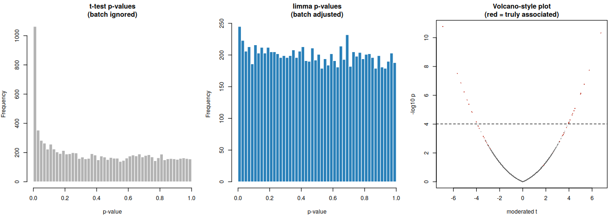
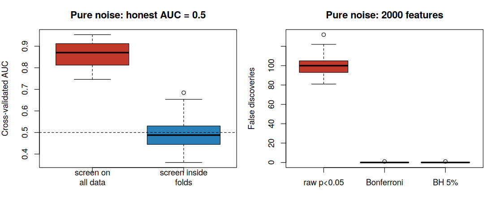
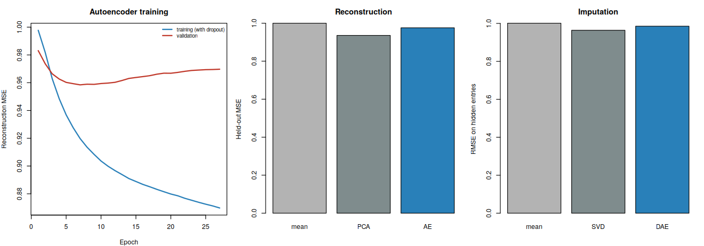
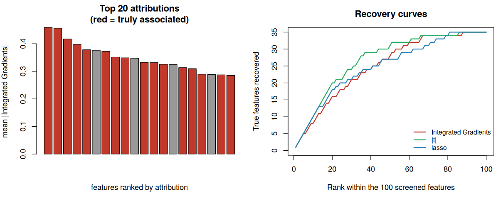

# Part 2: High-Dimensional Data Analysis, Prenatal Omics Biomarkers (R)

Statistical Programmer portfolio for a TPG / NICHD-style health study. The notebook `Part2_HighDimensional_Analysis_TPG.ipynb` analyzes **10,000 synthetic molecular features measured on 400 children** (far more features than children), linked to a binary outcome. It covers batch effects, multiplicity control, penalized regression with honest validation, selection stability, post-selection inference, a simulation study of common mistakes, and **neural networks tested against the classical methods under identical rules**.

> **All data are synthetic**, so the truth is known and every method is scored against it. Forty features are truly associated with the outcome; samples were processed in 4 batches whose effects are **confounded with the outcome** (outcome prevalence by batch: 0.67, 0.60, 0.30, 0.28).

## Methods and tools

| Question | Method | R tool | SAS equivalent |
|---|---|---|---|
| Is there a batch problem? | PCA, batch correction | `prcomp`, `limma::removeBatchEffect` | `PROC PRINCOMP`, `PROC MIXED` |
| Which features differ? | Moderated t-tests, Bonferroni, Benjamini-Hochberg FDR | `limma`, `p.adjust` | `PROC MULTTEST` |
| How well can the outcome be predicted? | Ridge, elastic net, lasso with nested cross-validation | `glmnet` | `PROC GLMSELECT`, `PROC HPGENSELECT` |
| Is the AUC above chance? | Permutation test | base R | `PROC SURVEYSELECT` + macro loop |
| Which features are reliable? | Stability selection, sample-splitting inference | `glmnet`, `glm` | `PROC HPGENSELECT`, `PROC LOGISTIC` |
| Neural alternatives | MLP, denoising autoencoder, sparse-input network, Integrated Gradients | base R (from scratch) | `PROC NNET` (SAS Viya) |

The equivalent SAS programs will be provided in the SAS appendix (not yet included in this repository).

## 1. Batch effects

The first three principal components are almost entirely batch (R-squared with batch 0.89, 0.92 and 0.94). After `limma::removeBatchEffect`, which does not use the outcome, the batch R-squared drops to 0 for every component.

## 2. Multiplicity and batch adjustment

With 10,000 tests, raw p-values are unusable. Because the truth is known, each approach is scored by true positives (TP), false positives (FP) and the realized false discovery proportion (FDP):

| Approach | Declared | TP | FP | FDP | Sensitivity |
|---|---|---|---|---|---|
| t-test, p < 0.05, no correction | 1566 | 36 | 1530 | 0.977 | 0.90 |
| t-test, Bonferroni 0.05 | 50 | 15 | 35 | 0.700 | 0.375 |
| t-test, BH FDR 5% (batch ignored) | 482 | 30 | 452 | 0.938 | 0.75 |
| limma + batch, p < 0.05 | 575 | 38 | 537 | 0.934 | 0.95 |
| limma + batch, Bonferroni 0.05 | 11 | 11 | 0 | 0.000 | 0.275 |
| **limma + batch, BH FDR 5%** | **23** | **21** | **2** | **0.087** | **0.525** |

Ignoring the batch confounding, even an FDR-controlling procedure reports 482 features of which 94% are false. Adjusting for batch with moderated tests gives 23 findings of which 21 are real.

## 3. Prediction with honest validation

Penalized logistic regression with **nested cross-validation** (penalty tuned by inner cross-validation on AUC, never on the test fold). AUC is computed within each held-out fold and averaged. Two validation schemes are compared: random 5-fold, and **leave-one-batch-out**, which mimics deployment on a new batch.

| Model (batch-corrected data) | AUC, random 5-fold | AUC, leave-one-batch-out |
|---|---|---|
| Lasso | 0.857 | 0.845 |
| Elastic net | 0.867 | 0.865 |
| Ridge | 0.493 | 0.502 |
| MLP, all 10,000 features | 0.470 | 0.534 |
| MLP, in-fold screening to 100 features | 0.765 | 0.846 |
| *(Lasso on uncorrected data)* | *0.929* | *0.893* |

- **Ridge fails.** I checked that this is not a coding bug: its best cross-validated deviance equals the null model's. The most likely reason is that, with 10,000 features of which 40 matter, ridge spreads weight over all of them and cannot isolate the sparse signal, while methods that select features (lasso, elastic net) do well.
- **Uncorrected data give a higher AUC**, especially under random splits (0.93). One reason is that the batch signature predicts the outcome, so that number is optimistic for a new batch; the corrected-data figures are the honest ones. Removing batch means also removes some genuine signal that is confounded with batch, so the corrected AUC is conservative. I have not separated these two effects further.
- **Permutation test.** The observed nested-CV AUC of the lasso is 0.834. Across 40 label permutations, the null AUC has mean 0.508 and maximum 0.572, so the permutation p-value is 0.024, the smallest value 40 permutations can give.

## 4. Which features? Selection stability and valid inference

| Selection method | Selected | TP | FP | FDP | Recall |
|---|---|---|---|---|---|
| Lasso, lambda.min | 52 | 28 | 24 | 0.46 | 0.70 |
| Lasso, lambda.1se | 39 | 25 | 14 | 0.36 | 0.625 |
| Stability selection (frequency >= 0.6) | 8 | 8 | 0 | 0.00 | 0.20 |
| limma + batch, BH 5% | 23 | 21 | 2 | 0.09 | 0.525 |

Stability selection trades recall for precision: its 8 features are all real, while the lasso at lambda.min keeps 24 false ones.

**Sample splitting.** Selecting features on one half of the data and testing them on the other half gives valid p-values; testing on the same data used for selection does not:

| Approach | Selected | p < 0.05 | True among those | False among those |
|---|---|---|---|---|
| Same data used to select (naive) | 17 | 16 | 9 | 7 |
| Independent half (sample splitting) | 17 | 6 | 5 | 1 |

The median p-value among selected features that are not truly associated is 0.002 under the naive approach and 0.42 with sample splitting.

## 5. Simulation study: what goes wrong when it is done carelessly

Repeated 40 times on **pure noise** (the honest answer is AUC = 0.5 and no discoveries):

| Procedure | Result |
|---|---|
| Screen the best 20 features on all the data, then cross-validate | Mean AUC **0.859** (range 0.75 to 0.95) |
| Screen inside each training fold | Mean AUC 0.494 (range 0.36 to 0.68) |
| Raw p < 0.05 across 2,000 features | 99.7 false discoveries per experiment |
| Bonferroni / BH 5% | 0.03 false discoveries per experiment |

## 6. Neural networks versus classical methods

All networks are written from scratch in base R, with gradients verified numerically (see Part 1), so no extra installs are needed.

**Dense MLP for prediction.** Given all 10,000 features, the network learns nothing (AUC 0.47 to 0.53), as shown in the table above. With the top 100 features chosen inside each training fold it becomes competitive (0.77 random folds, 0.85 leave-one-batch-out) but does not beat the elastic net (0.87, 0.87).

**Denoising autoencoder** (10-unit bottleneck, trained on 300 children, judged on 100 held-out children):

| Measure | Feature mean | PCA (10) | Autoencoder (10) | Lasso |
|---|---|---|---|---|
| Held-out reconstruction MSE (1.00 = feature mean) | 1.000 | **0.936** | 0.976 | |
| Imputation RMSE on 10% hidden entries | 1.001 | **0.964** (iterative SVD) | 0.985 | |
| Outcome AUC from a 10-dimensional summary | | 0.474 | 0.494 | **0.787** (all 10,000 features) |

The autoencoder beats the feature mean but not PCA or low-rank SVD at this sample size. Unsupervised compression into 10 dimensions keeps almost none of the outcome signal, because the outcome is carried by 40 specific features and not by the dominant modes of variation.

**Sparse-input network (group-lasso on the first layer).** The best-validated network keeps 157 features of which 26 are true; the number of survivors is not monotone in the penalty because training is noisy. Comparing the top 60 features by each method:

| Method | True in top 60 | False in top 60 |
|---|---|---|
| Sparse-input network (weight norm) | 23 | 37 |
| Lasso (absolute coefficient) | 28 | 32 |
| limma + batch (absolute moderated t) | **32** | 28 |

**Integrated Gradients (attribution).** Attributions are only as good as the model. For the dense MLP that learned nothing (a negative control), none of its top 40 features is a true feature (0 found; random ranking would find 0.16). For a network trained on the 100 screened features (screening used all labels, so this network illustrates attribution only and its performance is not reported), 16 of the top 20 by attribution are true features, against 20 by |t| and 18 by lasso, among 35 true features in the screened set. The attribution completeness check holds to 0.011.

## Conclusions

- Batch effects confounded with the outcome produce spurious discoveries and inflated validation scores unless they are modeled and validation matches the intended use.
- Multiplicity control, moderated tests with batch adjustment, stability selection and sample splitting each address a different failure mode, and the simulation study quantifies them.
- In this setting (400 samples, 10,000 features, a sparse linear signal), classical methods match or beat the neural networks and are much easier to validate and explain. Networks only become competitive after feature screening, and their attributions then add little over the screening statistic.

## How to run for beginners

1. Open `Part2_HighDimensional_Analysis_TPG.ipynb` in [Google Colab](https://colab.research.google.com) and choose **Runtime > Change runtime type > R**.
2. Click **Runtime > Run all**. The first cell installs `glmnet` and `limma` (limma comes from Bioconductor, which can take a few minutes the first time). Expect about 10 to 15 minutes in total.
3. Figures are saved to a `PIC/` folder as the notebook runs.

The notebook in this repository already contains the outputs from a complete run. Random seeds are fixed, so the data and classical results reproduce exactly; neural-network numbers can differ slightly on other machines.

## Limitations

- Synthetic data with a built-in sparse signal; the main comparisons use one simulated data set (the simulation study covers the failure modes with repetitions).
- Networks use fixed, lightly tuned hyperparameters.
- The feature count is 10,000 for runtime; the generator accepts a larger value.
- Batch-adversarial autoencoders, multi-omics networks, repeated omics measurements and the SAS appendix are not yet included (Part 3 and the SAS appendix are planned).
