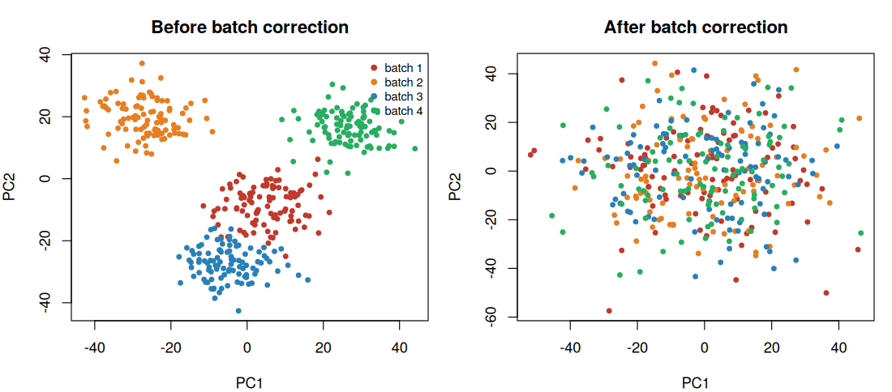
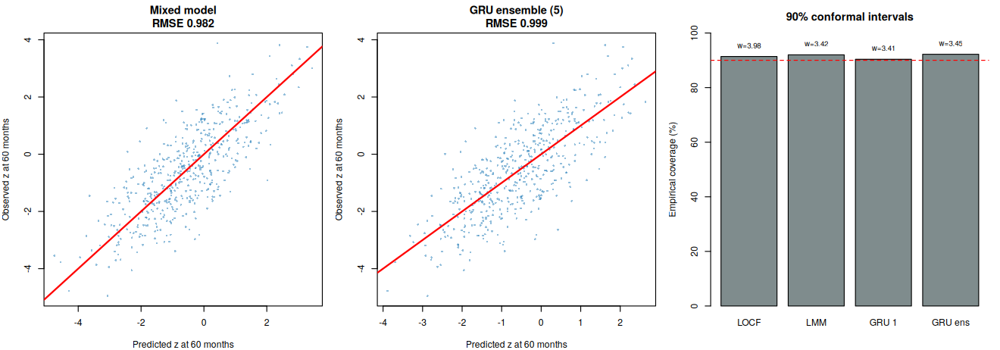

# Statistical Programmer Portfolio: Longitudinal and High-Dimensional Analysis in Child Health Research (R)

A portfolio of two complete, reproducible analyses written in **R** for a Statistical Programmer role supporting NICHD-style child-health studies. One analysis covers **longitudinal data** (a pediatric birth cohort followed from birth to age 5). The other covers **high-dimensional data** (10,000 molecular features measured on 400 children). Each analysis also tests **neural networks as competitors to the classical methods**, under identical validation rules, and reports honestly where they do and do not help.

> **All data are synthetic.** No real participants or patient information are used. The data are simulated so that the truth is known, which lets every method be checked against the correct answer. The results show how the methods behave, not what is true about real children.

## Contents

| File | What it is |
|---|---|
| [`Part1_Longitudinal_Analysis_TPG.ipynb`](Part1_Longitudinal_Analysis_TPG.ipynb) | Longitudinal analysis notebook (R, with all outputs saved) |
| [`README_Part1_Longitudinal.md`](README_Part1_Longitudinal.md) | Detailed write-up of Part 1 with tables and figures |
| [`Part2_HighDimensional_Analysis_TPG.ipynb`](Part2_HighDimensional_Analysis_TPG.ipynb) | High-dimensional analysis notebook (R, with all outputs saved) |
| [`README_Part2_HighDimensional.md`](README_Part2_HighDimensional.md) | Detailed write-up of Part 2 with tables and figures |
| `PIC/` | The 11 figures produced by the notebooks |

## How the portfolio maps to the job requirements

| Requirement in the posting | Where it is shown | Status |
|---|---|---|
| Longitudinal data analysis | Part 1: mixed models, covariance structures, GAMM, GEE vs GLMM, missing data, survival | Done |
| High-dimensional data analysis | Part 2: batch correction, FDR, penalized regression, stability selection, sample splitting | Done |
| Proficient R programming | Both notebooks (base R, `lme4`, `nlme`, `mgcv`, `geepack`, `mice`, `survival`, `glmnet`, `limma`) | Done |
| Strong knowledge of statistical theory | Documented reasoning for each method: assumptions, what each estimator targets, what can go wrong | Done |
| Health studies | Child-growth, neurodevelopment, asthma and omics-biomarker settings (synthetic data only) | Done (synthetic) |
| Present analysis results to a client | Every README states the result, the uncertainty and what it means in plain language | Done |
| Statistical programming and data management | Data simulation, reshaping, merging, quality checks, reproducible seeds | Done |
| SAS | SAS procedure names are listed beside each method; no SAS code is included yet | Planned |
| Study design, sample size and power calculation | Not yet included | Planned |
| Analysis plan construction | Notebooks follow a stated structure, but no formal statistical analysis plan document yet | Planned |

## Results at a glance

### Part 1: longitudinal analysis of a birth cohort

800 children, measured at birth and at 6, 12, 24, 36 and 60 months, with dropout (61% still observed at 60 months), missed visits and irregular visit times.

| Question | Finding |
|---|---|
| Does a prenatal exposure change BMI growth? | Estimated exposure-by-time effect **0.104 per year** (95% CI 0.082 to 0.125); true value 0.10 |
| Which covariance structure fits? | Random intercept and slope with continuous-time AR(1) errors (AIC 6343, against 8138 for random intercept only) |
| Marginal vs conditional effect, repeated binary outcome | Exposure OR **1.37** (population-average, GEE) vs **1.43** (child-specific, GLMM) |
| Is the conclusion robust to non-random dropout? | Yes: the exposure effect only becomes null if dropouts' effect is about 1 z-unit per SD lower than assumed (about twice the effect itself) |
| Neural network vs mixed model for predicting BMI at 60 months | GRU ensemble RMSE 0.999 vs mixed model 0.982; difference +0.017 (95% CI -0.019 to +0.053), **no advantage for the network** |
| Deep survival network vs Cox model (asthma) | C-index 0.576 vs 0.571, indistinguishable |

### Part 2: high-dimensional biomarker analysis

10,000 features, 400 children, 40 truly associated features, and batch effects confounded with the outcome.

| Question | Finding |
|---|---|
| What happens if batch is ignored? | A 5% FDR rule reports 482 features, **94% false**. With batch adjustment (limma): 23 features, 21 true |
| How bad is screening before cross-validation? | On pure noise, AUC **0.86** instead of 0.49 |
| How well can the outcome be predicted? | Elastic net AUC **0.87** (random folds) and 0.87 (leave-one-batch-out); permutation p = 0.024 for the lasso |
| Neural network on all features | AUC about 0.5: learns nothing |
| Neural network after in-fold screening | AUC 0.77 (random) and 0.85 (leave-one-batch-out), still not better than the elastic net |
| Autoencoder vs PCA | Reconstruction MSE 0.976 vs 0.936: PCA wins at this sample size |




## Plain-language takeaways

1. **Model the way the data were collected.** Repeated measures on the same child are related, and ignoring that gives wrong uncertainty. Mixed models and GEE handle it, and they answer different questions (an individual child vs the population).
2. **Say what you assume about missing data, and test it.** Dropout depended on earlier measurements. Several methods agree here, and a sensitivity analysis shows how far the assumption could be wrong before the conclusion changes.
3. **With thousands of measurements, correct for batch and multiplicity.** Otherwise most "discoveries" are false, and validation scores are inflated.
4. **Validate the way the model will be used.** Tuning inside cross-validation folds and testing on a new batch give honest performance. Screening on all the data first gives impressive, meaningless numbers.
5. **Neural networks are a tool, not an upgrade.** With a few hundred children, classical models were as good or better, easier to explain, and easier to defend. Networks would be worth revisiting with far more data and strongly nonlinear patterns.

## Design principles

- **Known truth.** Because the data are simulated, every estimate is compared with the value used to generate it. Where a method misses the truth, the notebook says so.
- **Honest validation.** Nested cross-validation, splits by child, leave-one-batch-out validation, permutation tests, and conformal prediction intervals.
- **Fair comparison.** Neural networks use the same folds, metrics and uncertainty tools as the classical methods, and paired bootstrap intervals judge whether differences are real.
- **Networks written from scratch in base R.** R's deep-learning package needs a large binary download, so the networks (multilayer perceptron, GRU with hand-written back-propagation through time, Cox-loss survival network, denoising autoencoder, sparse-input network, Integrated Gradients) are implemented directly. Every gradient is checked against finite differences before use (maximum relative error 9.9e-09 for the MLP, 2.5e-09 for the Cox loss, 2.2e-07 for the GRU). This means no extra installs in Colab. For large data you would use `torch` or `keras`.
- **Reproducible.** Fixed random seeds, executed notebooks with saved outputs, and every figure written to `PIC/`.

## Methods covered

| Area | Methods | R packages |
|---|---|---|
| Longitudinal | Linear mixed models, random slopes, CAR(1) covariance, GAMM (`bam`), likelihood-ratio tests, AIC/BIC, residual and random-effect diagnostics | `lme4`, `nlme`, `mgcv` |
| Repeated binary | GEE (exchangeable, independence), mixed-effects logistic regression, marginal vs conditional odds ratios | `geepack`, `lme4` |
| Missing data | Complete-case, mixed model under MAR, multiple imputation with Rubin's rules, delta-adjusted tipping-point analysis (MNAR) | `mice` |
| Survival | Cox proportional hazards, proportional-hazards test, cross-validated concordance, two-stage trajectory features | `survival` |
| High-dimensional testing | Moderated t-tests, Bonferroni, Benjamini-Hochberg FDR, batch adjustment | `limma` |
| Prediction | Ridge, lasso, elastic net, nested cross-validation, leave-one-batch-out, permutation test | `glmnet` |
| Selection and inference | Stability selection, sample-splitting inference, simulation study of screening leakage and multiplicity | `glmnet`, base R |
| Neural networks | GRU, deep ensembles, conformal intervals, Cox-loss network, MLP, denoising autoencoder, group-lasso sparse-input network, Integrated Gradients | base R (from scratch) |

## How to run

1. Open a notebook in [Google Colab](https://colab.research.google.com) (**File > Upload notebook**, or open it from GitHub).
2. Choose **Runtime > Change runtime type > R**.
3. Click **Runtime > Run all**. The first cell installs any missing packages.

| Notebook | Approximate runtime | Notes |
|---|---|---|
| Part 1 | 2 to 3 minutes | Installs `lme4`, `geepack`, `mice` if missing |
| Part 2 | 10 to 15 minutes | Installs `glmnet` and `limma` (limma comes from Bioconductor and can take a few minutes the first time) |

The notebooks in this repository already contain the outputs of a complete run, so you can read the results on GitHub without running anything. To run locally, you need R 4.3 or later with the packages above.

## Limitations

- **Synthetic data.** Effects and the dropout mechanism were built in by design. Performance numbers describe the methods in this simulation, not real-world performance.
- **One simulated dataset per comparison.** The simulation study in Part 2 repeats experiments to measure failure modes, but the main method comparisons use a single draw, so small differences should not be over-read. For example, in Part 1 the estimated sex effect on delay is far from its true value in this draw; an oracle check shows this is sampling variation.
- **Lightly tuned networks.** Networks use fixed hyperparameters on small samples. A larger or more irregular cohort could change the comparison.
- **Not yet included:** study design, sample-size and power calculation (Part 0); a joint longitudinal-survival model and a multimodal network that combines omics with growth trajectories (Part 3); a formal statistical analysis plan; and the SAS appendix with equivalent `PROC MIXED`, `GENMOD`, `GLIMMIX`, `MI/MIANALYZE`, `PHREG` and `GLMSELECT` programs. SAS procedure names are listed in the part READMEs, but no SAS code has been written or tested.

## Suggested repository layout

```
README.md                                    (this file)
Part1_Longitudinal_Analysis_TPG.ipynb
README_Part1_Longitudinal.md
Part2_HighDimensional_Analysis_TPG.ipynb
README_Part2_HighDimensional.md
PIC/                                         (unzip PIC.zip here)
```

## About

Built by [your name] as a work sample for a Statistical Programmer position supporting child-health research. Contact: [email / LinkedIn].
